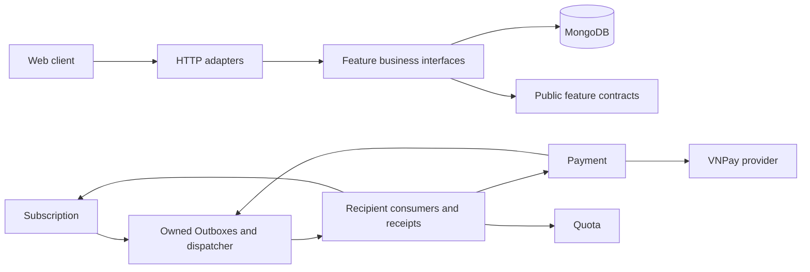

# System overview

EngoLearn Backend is one Spring Boot application, a feature-first modular monolith under `fit.iuh.engolearn`. HTTP adapters call business interfaces; repositories own MongoDB access. MongoDB must support transactions for Subscription, Payment delivery and Quota atomic writes. This layout does not imply separately deployed services.

The diagram separates technical delivery from module dependencies. Subscription imports Payment-owned commands/results; Quota imports Subscription-owned entitlement contracts. Payment does not depend on Subscription. Shared messaging provides leases, fencing, retry and envelopes without owning business policy. Each normal producer/consumer transaction writes only its module's state, Outbox or receipts. External provider calls happen outside database transactions. See the [module map](module-map.md), [communication policy](cross-feature-communication.md) and [delivery ADR](decisions/ADR-0002-durable-subscription-payment-quota-delivery.md).

Frontend success responses use `ApiResponse<T>` and failures use `ProblemDetail`. Provider protocol adapters have their required wire shape; VNPay IPN is raw `RspCode`/`Message`. Security and development identity mechanisms are described in [authentication](../runbooks/user-auth.md); development fixtures are not production identities.

Subscription, paid activation, full-refund core, durable delivery and the optional VNPay worker are implemented. VNPay is disabled by default. The user reported Sandbox IPN success and Premium activation; this migration did not retest it. Historical QueryDR response 99 remains unresolved; provider refund end-to-end is unverified. See the [module status](../technical/subscription/README.md) and [runbook](../runbooks/vnpay.md).
