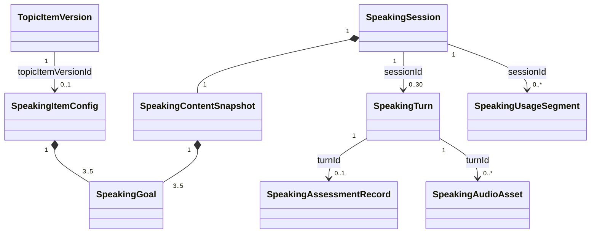

# Speaking with AI — BE migration

**Branch:** `feat/speaking-ai-baseline`
**Status:** Demo slice 0–3 merged with current `main` auth; live provider/browser validation is pending.
**Business baseline:** `SPK-UC-001..010`, `BR-38.*`, `BR-F1.*..BR-F3.*` in `docs/engolearn-business-doc/docs/usecase_spec/speaking-with-AI/`.

## Implemented on this branch

- Added the `speaking` feature root to the architecture allow-list and documented `speaking → topic.contract`.
- Added document models for per-item configuration, session, learner turn, assessment record, audio metadata, and usage segment. The assessment record contains no audio bytes or object key.
- Added a narrow `SpeakingItemLookup` contract on the Topic side. It resolves a published, visible item and the version pinned by a running learning attempt, checks the current level and preceding item for a new attempt, and returns only item data needed for a Speaking snapshot.
- Added reusable `shared.media.MediaStorage` and Cloudinary adapter. Speaking uploads WAV learner audio and MP3 AI audio through this interface as authenticated media; playback URLs expire after one minute.
- Added REST endpoints for item configuration, current/create/replace/resume/end sessions, account/item history, detail, soft delete, audio playback, and one-use WebSocket tickets. REST identity comes from `shared.security.CurrentUserProvider`; WebSocket tickets are issued only after the owner/epoch check. Speaking REST routes require authentication in `SecurityConfig`.
- Added PCM WebSocket handler and AssemblyAI streaming adapter, Gemini assessment, and Cartesia synthesis. Events carry `turnId`, `controllerEpoch`, and session revision. Turn IDs and usage segment IDs are stable to avoid duplicate writes.
- Added 20-minute/30-turn limits, 60-minute Asia/Ho_Chi_Minh usage segments, 30-day learner-recording playback expiry, explicit end with up to 10 seconds for a pending assessment, three consecutive assessment-failure termination, delayed interruption after disconnect, and startup recovery.
- Added Mongo indexes for unique item-version configuration, one open session per learner, and per-session turn sequence. Dev-only seed import accepts a JSON file containing real item/version IDs and curated goals. A separate fixed-ID dev fixture provides one published Topic item and Speaking configuration for direct integration testing.
- Added tests for goal rounding, pinned content, ownership rejection, midnight usage split, and an empty session ending.

## Intended relationships

`TopicItemVersion 1—0..1 SpeakingItemConfig`; `SpeakingSession 1—1 SpeakingContentSnapshot`; `SpeakingSession 1—n SpeakingTurn`; `SpeakingTurn 0..1—SpeakingAssessmentRecord`; `SpeakingTurn 0..n—SpeakingAudioAsset`; `SpeakingSession 1—n SpeakingUsageSegment`. Cross-feature references are IDs and Topic contract DTOs, not imported Topic entities.



The configuration collection is owned by Speaking. F03 authoring and synchronous publish validation are deferred; the Topic publish extension point must be designed before that work. Demo `SpeakingTopic` and its three test topics are not migrated.

## Local configuration

Use profile `dev` and sign in through the shared cookie auth flow. Speaking session ownership uses the authenticated account ID. Set `ASSEMBLYAI_API_KEY`, `GEMINI_API_KEY`, `CARTESIA_API_KEY`, `CARTESIA_VOICE_ID`, and `CLOUDINARY_URL` through the local `.env` or deployment secrets. No credential is committed. The optional `SPEAKING_DEV_SEED_FILE` points to a JSON array shaped like:

```json
[{"topicItemId":"<real item ID>","topicItemVersionId":"<real published version ID>","goals":[{"id":"g1","title":"...","description":"...","priority":"REQUIRED"},{"id":"g2","title":"...","description":"...","priority":"OPTIONAL"},{"id":"g3","title":"...","description":"...","priority":"REQUIRED"}],"goalPercentage":75,"minimumValidTurns":5}]
```

The default Gemini assessment model is `gemini-3.5-flash-lite`. The previous `gemini-2.5-flash` default returns HTTP 404 for new Gemini API users. Assessment failures mark the turn `FAILED` and emit `PROCESSING_ERROR` with an updated session snapshot; the server log records the underlying exception.

The JSON import is for actual published Topic item versions and business-approved goals. Separately, the `dev` profile creates an isolated test fixture at item ID `690000000000000000000002` with a published Topic release, item version, and three sample Speaking goals. The fixture is idempotent, also works when the Topic collection already contains data, and is not business-approved learner content. FE can open it at `/dev/speaking-session`. F03 authoring/publish integration remains the later delivery.

To use the fixed fixture, start MongoDB, run the backend with the `dev` profile, then open the FE development route. No `SPEAKING_DEV_SEED_FILE` is required for this fixture. Provider credentials and Cloudinary configuration are still needed for live audio turns.


## Opening configuration and local café seed

Each published `speaking_item_configs` document includes `context` (the scenario used for learner guidance), `learner_role`, `ai_role`, and `opening_side` (`LEARNER` or `AI`), alongside its existing item/version IDs, goals, and turn settings. The dev seed file `tools/mongo-json-importer/samples/speaking-ai-cafe-opening-configs.json` is a config-only importer pack. It keeps the existing café Topic and item/version IDs intact and contains both opening branches:

| Café item | Learner / AI roles | Opening side |
| --- | --- | --- |
| Order a Drink (`691b00000000000000000003`, version `691b00000000000000000006`) | customer / barista | AI |
| Correct the Order (`691b00000000000000000004`, version `691b00000000000000000007`) | customer / barista | LEARNER |
| Pay and Leave (`691b00000000000000000005`, version `691b00000000000000000008`) | customer / barista | LEARNER |

To open a café item directly in the dev Speaking view, use `/dev/speaking-session?itemId=<item ID>` with one of the IDs above. The regular Topic route is `/topics/<topic ID>/speaking`; it resolves items through the learner flow. The fixed fixture route `/dev/speaking-session` without an `itemId` remains a separate integration fixture.

Session creation stores and returns the opening snapshot immediately. AI opening generation and synthesis run asynchronously after save; clients follow `OPENING_UPDATED` snapshots. A failed AI generation can be retried by the current controller with `POST /api/v1/speaking/sessions/{id}/opening/retry` and a `SpeakingControlRequest` carrying `requestId` and `controllerEpoch`. `GET /api/v1/speaking/sessions/{id}/opening/audio` returns a short-lived playback URL for the session owner's available opening audio. Opening guidance and audio do not count as learner turns. Audio-only failure keeps the generated text available without audio.

Before importing or resetting local Speaking data, confirm the intended Mongo container, port, and database in the importer command and perform its dry-run/preflight. Keep this seed limited to the `speaking_item_configs` collection; do not use a database-wide drop/reset. The approved dev reset scope, when needed, is the six Speaking collections only: `speaking_assessments`, `speaking_audio_assets`, `speaking_item_configs`, `speaking_sessions`, `speaking_turns`, and `speaking_usage_segments`. Preserve Topic and account collections. Stop the dev backend before a reset, verify preflight targets `engolearn_db` on the intended local Mongo endpoint, and confirm the imported config item/version IDs and opening fields afterward.
## Slice 0–3 manager demo

The approved response-policy proposal adds the dev/demo-only draft contract
`speaking.ai.draft.v2`. It keeps v1 readers and historical `hint` values,
while new assessments may persist nullable `hintExampleEn` and `hintLeadVi`.
The manager answers the learner's current meaning before connected goal
guidance; an unsuitable candidate falls back to clarification. Closing turns
use a short goodbye and suppress both hint fields. Shared validation and live
conversation quality evidence remain required before production activation.

### V2 goal evidence and hints (2026-11-05)

The V2 goal-evidence policy follows the user-approved baseline change:
the LLM decides whether the learner fulfilled a goal in context and returns
its pinned `goalId` and a nonblank `quote`. The backend accepts evidence for
pinned, not-yet-achieved goals once per goal. It does not compare the quote
with the transcript or goal description, or reject goal evidence because it
contains questions, negation or quotation marks. Quote accuracy and semantic
assessment are the LLM's responsibility; the prompt still instructs it to
quote the current finalized learner turn and use history only as context.
Consequently, a wrong model assessment or an invented quote may be accepted
when its goal ID is valid. V1/legacy and resource-evidence checks are unchanged.

For BR-F1.15 and BR-F1.41, the V2 prompt requires exactly one short English
learner-next-turn example (`hintExampleEn`) on every valid continuing,
nonclosing turn; a short Vietnamese lead (`hintLeadVi`) is optional. Closing
and terminal delivery keep suppressing hints. This is a prompt requirement
only: missing hints do not invalidate an otherwise valid assessment, and no
retry or backend hint fallback is added. Public schemas and stored historical
assessments remain unchanged; existing sessions are not re-assessed.

The manager runtime is disabled by default. Run the isolated backend with the
existing Speaking demo gate and the manager flag explicitly enabled:

```powershell
.\mvnw.cmd spring-boot:run -Dspring-boot.run.profiles=dev `
  -Dspring-boot.run.arguments="--engolearn.speaking.demo.manager.enabled=true"
```

The flag is effective only when `engolearn.speaking.demo.enabled=true` and the
active profile is not `prod`. The manager path keeps the existing REST and
WebSocket event names, adds optional `demoDecision` diagnostics to committed
`TURN_RESULT`/evaluation-failure `PROCESSING_ERROR` events, and suppresses
normal speech for recovery, invalid, terminal, unavailable, or rejected turns.
This demo is single-instance and intentionally does not claim Slice 4
transaction, CAS, outbox, or delivery guarantees.

Rollback is the default behavior: restart with
`--engolearn.speaking.demo.manager.enabled=false` (or omit the flag) to select
the legacy evaluator path.

## Known gaps before acceptance

- Full provider/browser and 10–20 concurrent-session tests need a running MongoDB, real test item/configuration, credentials, and Chrome/Edge/Safari. No p95 claim is made.
- The current usage adapter measures speech-capture and provider processing intervals. It has not been validated against actual AI audio playback duration or weak-network timing. Limits are enforced from persisted segments, but cost/latency measurements need live tests.
- The synchronous `synchronized` guards only cover one JVM; Mongo indexes and optimistic versioning protect core uniqueness, but replacement/finish concurrency across instances and an atomic assessment+progress write still need integration tests and hardening.
- End waits for a pending assessment up to 10 seconds. Automatic endings caused by age, replacement, quota, or deletion currently finish immediately, so those paths do not yet satisfy BR-F1.23 when an assessment is pending.
- The fixed dev fixture supports local integration testing only. Other Topic items still return `CONFIG_MISSING` until their approved Speaking configuration exists.
- Cross-component design based on FRC v0.6 is still awaiting the independent validation/publication gate in `.opencode/workflow/artifact-conventions.md`.

## Verification

### Session opening, 2026-11-07

- Speaking, provider-adapter and architecture suites passed with 195 tests,
  zero failures and zero errors in the complete local run.
- Full `mvnw.cmd -q verify` ran 575 tests with 5 failures and 74 errors.
  Failing suites are in Topic and Subscription. The report includes missing
  test beans, an integration Mongo index-build/drop-database race, and the
  Topic assertions already observed at the checkpoint. See
  `target/speaking-opening-verify-local.log` and Surefire reports.
- Backend startup succeeded on port 8080. On this Windows runner, set
  `JDK_JAVA_OPTIONS=-Djdk.net.unixdomain.tmpdir=<worktree>/target/tmp`
  with an existing short directory to avoid the sandbox TEMP path issue.
  This setting was applied to the verification processes.
- The real frontend route returned HTTP 200. Its proxy and the direct
  protected Speaking API returned HTTP 401 without authentication.
- Seed preflight used the existing importer with `MONGO_IMPORT_APPLY`
  unset. The six approved Speaking collections were backed up under
  `/tmp/engolearn-speaking-opening.vPj8r2` in `mongodb_srv`, then reset
  and seeded in one Mongo transaction. Three café configurations were
  inserted. Counts for 15 account/Topic collections matched before and
  after reset.
- Live Gemini/Cartesia checks are deferred to the user. Browser interaction
  was blocked by the computer-use tool's URL-policy support for Cốc Cốc on
  Windows. Audio playback, authenticated end-to-end flow and p95 latency
  still require manual verification.

- 2026-11-05 V2 goal/hint update: validator, prompt, composer, runtime, manager
  and gateway suites passed (147 tests, no failures/errors); independent review
  found no remaining issues. Full `mvnw.cmd -q verify` was attempted both inside
  and outside the sandbox and failed. The outside-sandbox run reported 558
  tests, 3 failures, 128 errors: context startup hit HTTP-client loopback
  `Invalid argument: connect`; TopicBrowseServiceImplTest, TopicQuizAnswerTest
  and TopicQuizReadTest also failed. Full-repository verification is incomplete;
  live provider/browser validation remains pending. Logs are in
  `target/speaking-v2-verify.log` and `target/speaking-v2-verify-unsandboxed.log`.
- `mvnw.cmd -q -DskipTests compile`: passed after provider, WebSocket, REST, and Cloudinary code.
- `mvnw.cmd -q '-Dtest=ArchitectureTest,SpeakingItemConfigTest,SpeakingSessionServiceTest' test`: passed. An earlier Mockito-based service test stalled because dynamic JVM attachment was denied on this host; it was replaced by interface fakes, then passed. No test was disabled.
- `.\mvnw.cmd -q verify`: BUILD SUCCESS; 327 tests ran with 0 failures and 0 errors, and 14 Docker-dependent tests were skipped because no Docker environment was available. Spring context checks also logged the expected unavailable MongoDB connection to `localhost:1`; the full Maven verification still completed successfully.

`SpeakingMongoIndexes` ensures the three uniqueness indexes at startup. A deployment with duplicate existing data must reconcile those records before startup can succeed.
