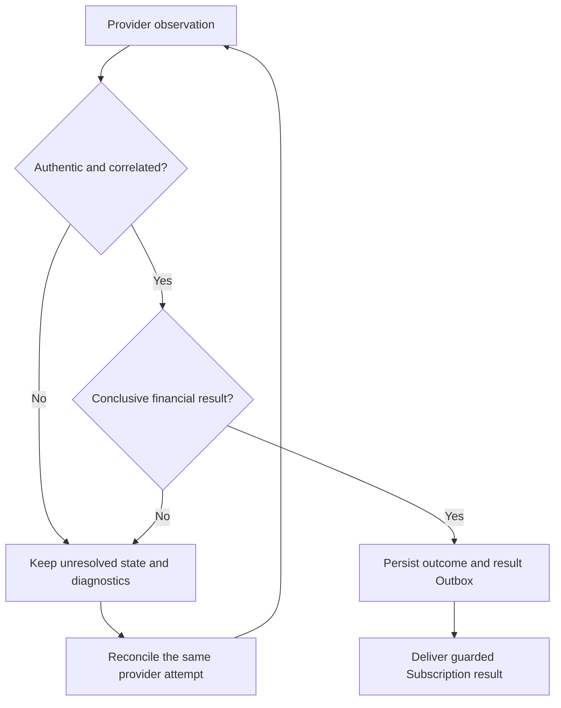
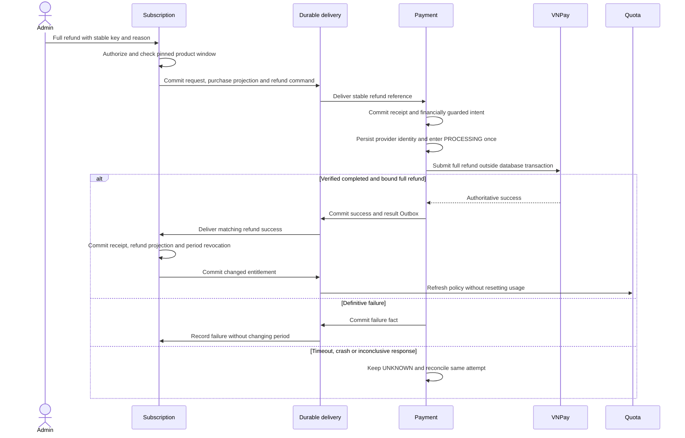

# Payment uncertainty and full refund

[Purchase and activation](purchase-and-activation.md) owns checkout/IPN sequencing. Payment owns provider authenticity, financial state and unknown outcomes; Subscription owns purchase/product eligibility and entitlement changes. Browser Return, local expiry, unsigned API 99 and transport errors never prove failure or success.

A verified PAY failure requires transaction status `02` and a well-formed non-success response code, not a short code whitelist. Pending/reversal/fraud and contradictory results stay unresolved/reviewable. An issued checkout's deadline alone does not free its purchase. A never-issued intent received after deadline can expire safely. Reconciliation diagnostics and the unresolved historical QueryDR 99 are in the [runbook](../../runbooks/vnpay.md).

Product eligibility is pinned to `paidAt <= request time < refundEligibleUntil`: seven days monthly, thirty days annually. Pending/unknown refund blocks another attempt and new purchase while retaining existing rights. Same key/actor/reason returns the original attempt; definitive failure requires a new authorized key and fresh eligibility check.

Payment derives the full original amount, serializes outcomes on the payment and permits at most one successful full refund. Processing/unknown work is reconciled, never blindly resubmitted. QueryDR showing the original payment is insufficient refund evidence. Without a known provider refund transaction number, a later signed refund observation may still be unbound and require manual review.

Only a matching verified final success revokes the bound non-Trial period. Failure leaves the period unchanged, including natural expiry. Old attempt facts cannot clear a newer attempt; contradictions are durably reviewed. Refund never restores superseded Trial or clears usage. Subscription exposes `REQUESTED` until a final fact; Payment's intermediate `PROCESSING`/`UNKNOWN` are internal. Real Sandbox refund end-to-end and an operator review/replay UI remain unverified/unimplemented respectively. See [technical contracts](../../technical/subscription/module-contract.md).
