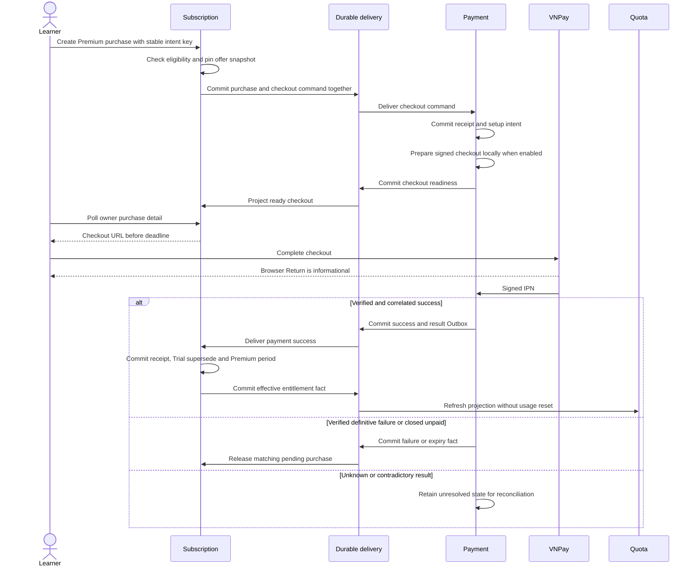
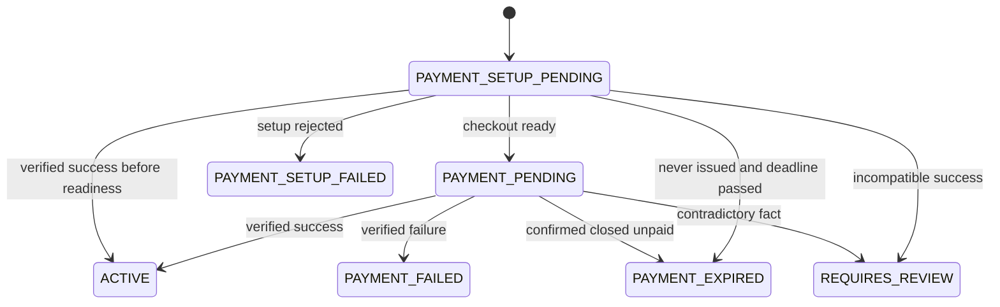

# Purchase and activation

The checkout URL is locally constructed by Payment; preparation does not charge the learner. With VNPay disabled, setup intents remain queued. A valid same-user/key/selection replay returns the original purchase and pinned price. A new key cannot bypass active Premium, a blocking purchase or a pending refund. Trial permits purchase. Missing account provenance or published policy data fails unavailable rather than inventing eligibility.

This is the normal purchase projection, not every defensive transition or Payment's internal state. Local deadline/Return does not establish failure or unlock an issued/uncertain purchase. Success is duplicate-safe and may arrive before readiness; later failure cannot regress an activated purchase. Unmatched identities, amount/currency, impossible times or overlapping periods are held for review.

Activation supersedes an overlapping Trial at verified `paidAt`, retaining its original scheduled end and `supersededAt` history. Premium uses the purchase's immutable policy/benefits snapshot and starts at `paidAt`, adding one calendar month/year in `Asia/Ho_Chi_Minh` with end-of-month clamping. Delivery never extends the interval. A fully elapsed interval is stored as an expired period even though purchase status records successful activation as `ACTIVE`; current rights come from time-based entitlement resolution. Trial is never reissued or restored. Same-window usage is retained.

For the one-time seven-day Trial, the learner activates with an idempotency key: receipt, trial-used flag, period and entitlement Outbox commit atomically. A replay returns its original activation; an existing active Trial does not extend. Later Free fallback uses current effective policy. See [API](../../technical/subscription/api-contract.md) and [refund/uncertainty](payment-and-refund.md).
