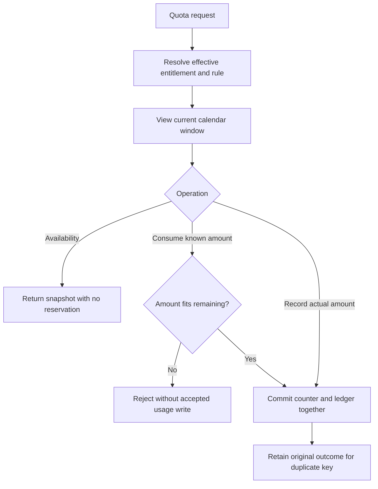
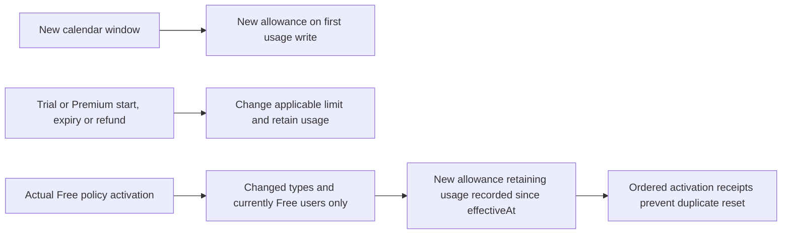

# Quota lifecycle

Subscription selects immutable period policy snapshots or current Free policy. Quota owns calendar windows, counter/ledger writes and enforcement. A missing/expired projection resolves through Subscription's public entitlement capability; failure is unavailable, never assumed Free or zero usage.

Availability can refresh an entitlement projection but writes no usage. `consume` conditionally admits a known amount; `recordUsage` records truthful actual usage even over the limit. Remaining is `max(0, limit - used)`, with `AVAILABLE`, `EXHAUSTED` or `OVER_LIMIT`. A stable accepted key returns its original result across later boundaries; changed payload conflicts. Recording uses first accepted server `recordedAt`; optional `occurredAt` is audit context, not backdating.

Windows are half-open in `Asia/Ho_Chi_Minh`: daily midnight, Monday weekly and first-of-month monthly; stored instants are UTC. Reads derive a new-window zero view without a reset job or counter mutation. A tier/period change never resets that window's usage. Free-policy activation is the distinct selective reset cause; delayed processing preserves usage accepted after the activation time and leaves old ledger entries intact. Existing Premium/Trial snapshots and unaffected types are not reset. Stale activation sequences cannot reapply.

Admin publication is immutable: FREE becomes effective next Vietnam midnight; TRIAL/PREMIUM `NOW` or scheduled `AT` affects new periods. Saving a future policy is not activation. Actual activation and entitlement facts travel through durable Outbox/receipts under [ADR-0002](../../architecture/decisions/ADR-0002-durable-subscription-payment-quota-delivery.md). Request-time lookup is not missed-policy replay and no historical pre-Outbox backfill is claimed.

Speaking/Proficiency producers are not integrated in this checkout. Their contract obligations remain: record each measured audio turn once (a turn first accepted after midnight belongs wholly to the new day); Proficiency must combine attempt/timer and `consume` in its caller-owned transaction before exposing content. See [Quota capabilities](../../technical/subscription/module-contract.md#quota-owned-capabilities).
